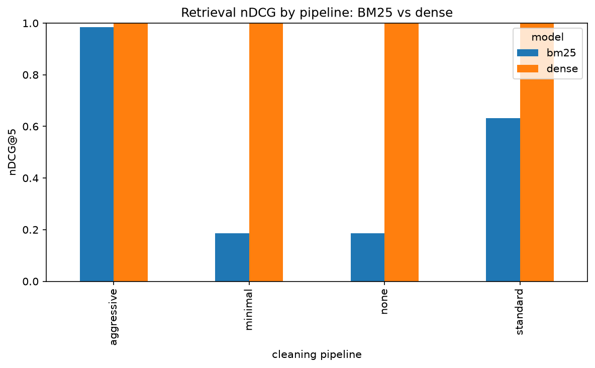
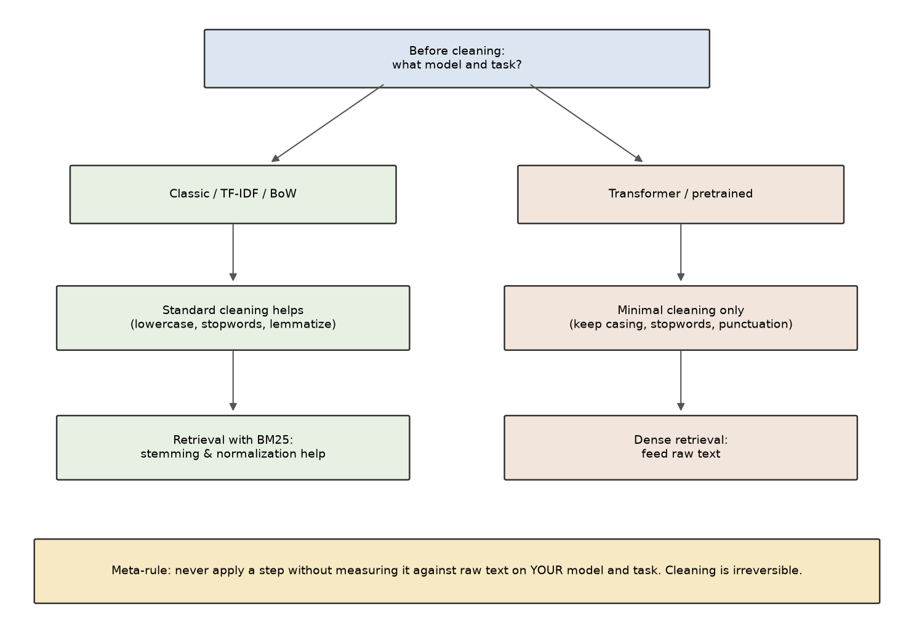

# text_cleaning_arena

**Every text-cleaning step you were taught is hurting your modern NLP model.**

A head-to-head benchmark of the standard text-preprocessing pipeline — lowercasing,
stopword removal, stemming, lemmatization, punctuation stripping, number removal —
against doing almost nothing, measured on **classification** and **retrieval** with both
**classic bag-of-words** models and **modern transformer embeddings**.

The cleaning ritual that opens every NLP tutorial was designed for sparse bag-of-words
models. Transformers were pretrained on raw text — casing, stopwords, and punctuation
included — and learned to use all of it. This repo measures what that ritual costs, on
your kind of task, with the un-cleaned baseline that almost nobody runs.

Everything runs on a **2-CPU / 8 GB GitHub Codespace, no GPU**.

---

## The headline results

**1. Stopword removal deletes negation and flips the label.** `not good` → `good`.
Across the sentiment corpus, the `standard` and `aggressive` pipelines delete **33**
negations (`not` / `no` / `never`) — asserted in the test suite so it can never silently
regress.

**2. The same cleaning helps one retriever and does nothing for the other.** Aggressive
normalization merges `running` / `runs` / `runner`, so **BM25's nDCG climbs from 0.19 to
0.98**. A dense encoder already knows those forms are related, so it sits at **1.0
regardless** — cleaning buys it nothing.



**3. For the transformer, more cleaning is worse.** On both sentiment and topic, the
transformer's best pipeline is `none` or `minimal`; the kitchen-sink `aggressive`
pipeline is its worst. Keep the casing, stopwords, and punctuation it was pretrained on.

> **Honest note.** These corpora are small and synthetic, so classification sits near the
> ceiling (the transformer hits 1.0 on raw sentiment). The dramatic "cleaning *helps*
> TF-IDF while *hurting* the transformer" opposite-directions effect needs longer, noisier
> real documents — here cleaning hurts both, the transformer most. The negation flip and
> the retrieval split are the clean, guaranteed demonstrations. Swapping in a real dataset
> (SST / IMDB / AG News) sharpens the classification story; the harness is ready for it.

---

## What's in the arena

| Axis | Options |
|---|---|
| **Cleaning pipelines** | `none` (raw) · `minimal` (whitespace/unicode only) · `standard` (lowercase + stopwords + lemmatize) · `aggressive` (everything + stemming + number removal) |
| **Models** | TF-IDF + logistic regression · BM25 (Okapi) · transformer embeddings (`all-MiniLM-L6-v2`, CPU) |
| **Tasks** | Sentiment classification · topic classification · small retrieval set with relevance judgments |

The individual steps (lowercase, stopwords, stem, lemmatize, punctuation, numbers) are
each toggleable and each reports what it does to vocabulary size and what information it
destroys.

---

## Notebooks

Run top to bottom; each saves its figures to `outputs/figures/` (PNG) and its tables and
numbers to `outputs/data/` (JSON).

| # | Notebook | What it shows |
|---|---|---|
| 01 | [The Ritual Pipeline](notebooks/01_the_ritual_pipeline.ipynb) | Each step applied to a sentence; the vocabulary reduction each one buys |
| 02 | [What Cleaning Destroys](notebooks/02_what_cleaning_destroys.ipynb) | Negation deletion, casing collapse, punctuation loss, stemming into non-words |
| 03 | [Old Models vs New Models](notebooks/03_old_models_vs_new_models.ipynb) | The same cleaning on TF-IDF and the transformer, side by side |
| 04 | [Arena: Classification](notebooks/04_arena_classification.ipynb) | 4 pipelines × 2 models × 2 tasks, cross-validated |
| 05 | [Arena: Retrieval](notebooks/05_arena_retrieval.ipynb) | 4 pipelines × BM25 and dense retrieval |
| 06 | [Decision Framework](notebooks/06_decision_framework.ipynb) | The flowchart, plus the `clean` and `evaluate_cleaning` utilities |



---

## Quickstart

In a GitHub Codespace (or any Python 3.11+ box with [`uv`](https://docs.astral.sh/uv/)):

```bash
make setup      # install deps, nltk data, and the Jupyter kernel
make data       # cache the frozen corpora
make embed      # pre-compute transformer embeddings (one-time; cached)
make test       # run the test suite
make notebooks  # execute all six notebooks end to end
make run        # launch the Streamlit app on :8501
```

`make ci` (sync + lint + test) is the green bar. First notebook run is under 8 minutes;
cached reruns are under 2.

### The two utilities you'll actually reuse

```python
from src.cleaning.pipelines import clean
from src.evaluation.comparison import evaluate_cleaning
from src.models.bow import BowClassifier

clean("The movie was NOT great!", "standard")        # -> 'movie great!'  (negation gone)

# Measure, don't assume: run every pipeline on YOUR data and YOUR model.
evaluate_cleaning(texts, labels, BowClassifier)        # cross-validated scoreboard
```

---

## The decision framework

- **Classic bag-of-words / TF-IDF** → standard cleaning usually helps; apply it.
- **Transformer or any pretrained model** → minimal cleaning only; keep casing, stopwords, punctuation.
- **Sparse retrieval (BM25)** → stemming and normalization help (more term overlap).
- **Dense retrieval** → feed the raw text the encoder expects.
- **Sentiment / any task where negation or tone carries the label** → never remove stopwords.
- **The meta-rule** → never apply a cleaning step without measuring it against raw text on
  your model and task. The step is irreversible, and the ritual is optimized for models you
  probably aren't using.

---

## Project layout

```
src/cleaning/     steps, named pipelines, vocabulary/information-loss analysis
src/models/       bow (TF-IDF+LogReg), bm25 (Okapi), transformer (cached, lazy-loaded)
src/datasets/     frozen corpora (sentiment, topic, retrieval, adversarial)
src/evaluation/   classification (CV), retrieval (nDCG/recall), negation flips, arena
app/              Streamlit app              notebooks/   the six notebooks
outputs/figures/  PNG figures (committed)    outputs/data/  JSON results (committed)
```

Built with `uv`, `sentence-transformers` (CPU `torch`), `scikit-learn`, `nltk`, `numpy`,
`pandas`, `matplotlib`, `streamlit`, `pydantic`; linted with `ruff`, type-checked with
`ty`, tested with `pytest`.

---

## Related projects

Part of a series of hands-on, CPU-only data-science projects. The most relevant:

- [**embeddings_101**](https://github.com/Dima806/embeddings_101) — what modern text models actually consume, from word co-occurrence counts up to a trained-from-scratch word2vec and a sentence encoder. *(This arena isolates the preprocessing those models hold fixed.)*
- [**retrieval_arena**](https://github.com/Dima806/retrieval_arena) — TF-IDF, BM25, dense bi-encoders, hybrid fusion, and cross-encoder reranking compared across corpora.
- [**transformers_101**](https://github.com/Dima806/transformers_101) — the architecture behind the sentence encoder here, built from scratch in numpy at toy scale.
- [**rag_101**](https://github.com/Dima806/rag_101) — retrieval-augmented generation end to end on CPU; a RAG system is four plain parts, and quality is capped by retrieval.
- [**scaling_arena**](https://github.com/Dima806/scaling_arena) — the sibling "preprocessing everyone applies blindly" arena, for seven feature-scaling strategies across six model families.
- [**encoding_arena**](https://github.com/Dima806/encoding_arena) — seven strategies for high-cardinality categorical features under controlled signal and cardinality.
- [**feature_engineering_arena**](https://github.com/Dima806/feature_engineering_arena) — feature-engineering transforms on datasets where the signal is planted in a form the raw feature hides.
- [**missing_data_imputation_arena**](https://github.com/Dima806/missing_data_imputation_arena) — the preprocessing-decision-as-a-measured-tradeoff format, applied to missing-data imputation.

More at [github.com/Dima806](https://github.com/Dima806).

---

## License

[Apache-2.0](LICENSE).
